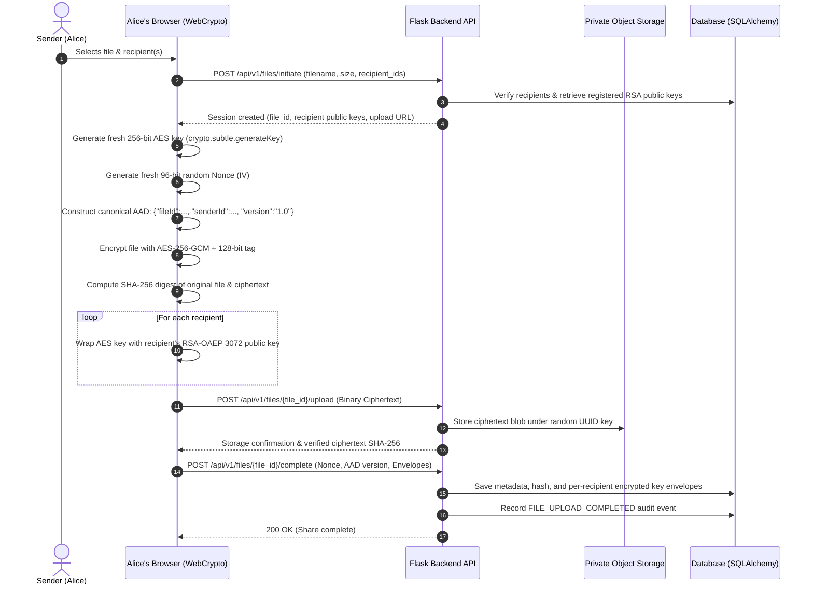
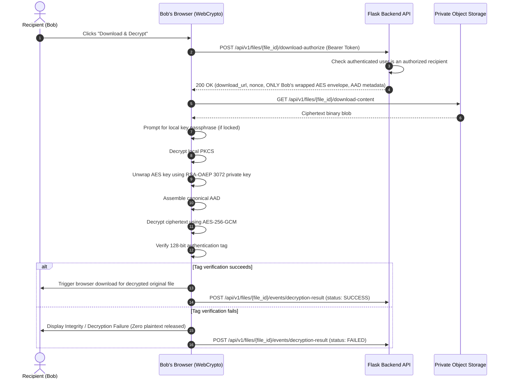
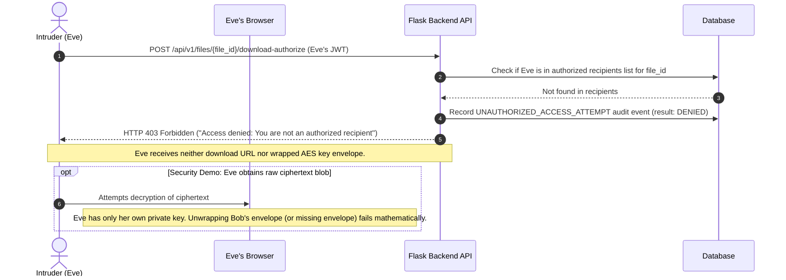
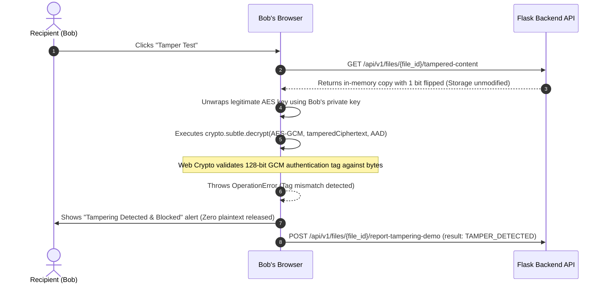

# CipherShare Architecture Specification

## 1. High-Level Component Architecture

CipherShare is designed with strict client-server separation to enforce the zero-knowledge security principle: **the cloud stores ciphertext, but never possesses plaintext or private keys**.

```mermaid
graph TD
    subgraph ClientBrowser ["Browser Client (Web Crypto API)"]
        UI["React + TypeScript UI"]
        SubtleCrypto["crypto.subtle (W3C Web Crypto)"]
        IndexedDB["IndexedDB (PBKDF2-Encrypted Private Key Vault)"]
        RAM["Volatile RAM (Ephemeral AES Key)"]
    end

    subgraph BackendGateway ["Flask Application Backend (Python 3.12)"]
        API["REST API Router (/api/v1)"]
        AuthSvc["Auth Service (Argon2id + JWT)"]
        AuditSvc["Audit Service (Scrubbed Metadata)"]
        StorageAdapter["Storage Service Abstraction"]
    end

    subgraph Persistence ["Persistence Layer"]
        DB[("PostgreSQL / SQLite Database")]
        Storage[("Private Object Storage (Local / Supabase)")]
    end

    UI --> SubtleCrypto
    SubtleCrypto --> IndexedDB
    SubtleCrypto --> RAM
    UI -->|JSON API (JWT Auth)| API
    API --> AuthSvc
    API --> AuditSvc
    API --> StorageAdapter
    API --> DB
    StorageAdapter --> Storage
    UI -->|Ciphertext Binary Upload/Download| StorageAdapter
```

---

## 2. Sequence Diagrams

### 2.1 Sender File Upload & Multi-Recipient Hybrid Encryption



### 2.2 Recipient Download & Client-Side Decryption



### 2.3 Unauthorized Intruder Attempt (Eve)



### 2.4 Controlled Tampering Detection Demo



---

## 3. Storage Design

The backend uses a uniform `BaseStorageService` interface:

- `LocalStorageService`: Stores encrypted binary blobs in `backend/storage/encrypted_blobs/`. Filenames are assigned random UUIDs (e.g. `f47ac10b...enc`). Path traversal is strictly prevented through canonical resolution checks.
- `SupabaseStorageService`: Stores encrypted blobs in private Supabase Storage buckets. Authenticated via `SUPABASE_SERVICE_ROLE_KEY` held exclusively on the Flask backend.

Plaintext file names are never used as storage keys; they remain stored only as metadata in the database.

